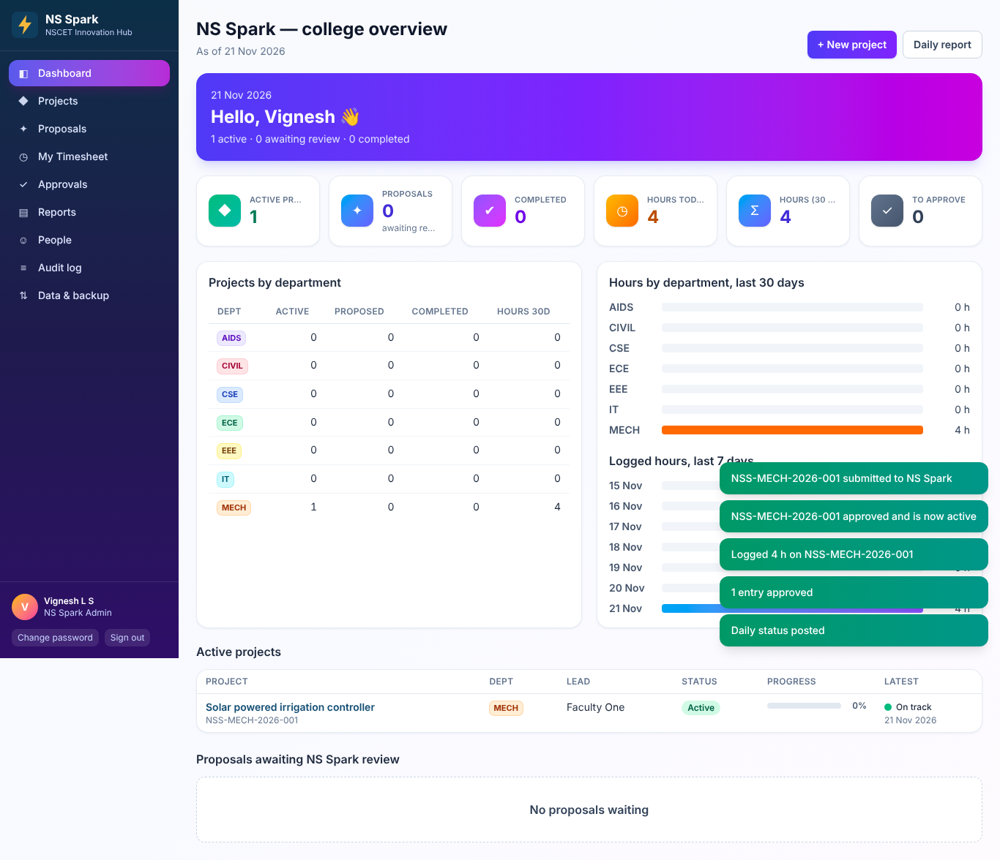

# NS Spark — NSCET Innovation Project Tracker

**App:** https://vigneshls.github.io/nscet-ns-spark/

NS Spark is the single umbrella for innovation projects across the seven departments of Nadar Saraswathi College of Engineering and Technology (an initiative under TMHNU). HoDs propose projects, NS Spark reviews and approves them, faculty and students log daily work, and the Secretary and Principal get a daily and a monthly report.



## How to start

1. Open the app. The first visit shows **First-time setup**: create the NS Spark admin account.
2. **People → Add person**: add one HoD per department (with a temporary password).
3. Each HoD signs in and adds their faculty and students: **People → Add many** accepts lines pasted from Excel (`Name, Email, Register no, Year`).
4. HoD → **+ New project**: title, team, description, problem/solution, technical stack, TRL, workstreams and tasks → **Submit to NS Spark**.
5. Admin → **Proposals** → Approve. Team members then log time in **My Timesheet**; project faculty approve it in **Approvals** and post the daily status.
6. **Reports** → daily or monthly → **Print / Save PDF** for the Secretary and Principal.

## Important: where the data is stored (phase 1)

There is **no backend yet**. Everything is saved in the browser of the computer you use:

- Use **one main computer** for NS Spark. Other computers and phones start empty.
- Clearing the browser's site data deletes everything — go to **Data & backup → Download backup** regularly. **Restore** brings a backup back on any computer.
- Passwords are salted and hashed (PBKDF2-SHA-256), never stored in plain text. This is not server-grade security: anyone with access to that browser profile can read the project data.

Phase 2 connects the shared database so every device sees the same live data (see below).

## Features

- Panels for **NS Spark Admin**, **HoD**, **Faculty**, **Student**, **Secretary / Principal (view only)**.
- Colour-coded departments: CSE, AIDS, IT, MECH, ECE, EEE, CIVIL.
- Project proposals with review workflow (approve / request changes / reject, with notes) and automatic codes (`NSS-MECH-2026-001`).
- Timesheet **format** from the reference workbook (structure only, no data): workstreams ("towers") with tasks numbered from the workstream's initial (H1, H2… S1…), member roles (Faculty Lead, Co-Faculty, Tower Lead, SME, Lab Technician, Student, Student Intern), and a month grid of person × task × day.
- Timesheet rules: max 12 h per person per day, no future dates, 7-day backdating limit, nobody approves their own entry.
- Daily project status (green / amber / red, blockers, next plan).
- Daily and monthly reports, print / PDF / CSV. HoDs get a department-only report.
- People management, password reset, audit log, backup / restore.

## Phase 2 — connect the database (later)

`supabase/schema.sql` contains the full multi-user database: tables, the 7 departments, Row Level Security policies, integrity triggers and audit log (tested with PGlite in `tests/schema.test.ts`). To switch over:

1. Run `supabase/schema.sql` in a Supabase project (SQL Editor).
2. Add a file `.env.production` with `VITE_SUPABASE_URL` and `VITE_SUPABASE_ANON_KEY` (publishable key — never the service-role key), commit, push.
3. Set Supabase **Authentication → URL Configuration → Site URL** to the app address.

The app then uses Supabase sign-up/sign-in automatically; no code changes are needed. Existing phase-1 data can be moved over from a backup file (an import script is a planned addition).

## Development

```bash
npm ci
npm run dev        # http://localhost:5173/nscet-ns-spark/
npm test           # unit tests + database RLS tests (PGlite)
npm run build      # dist/
```

Pushing to `main` builds, tests and deploys to GitHub Pages (`.github/workflows/deploy.yml`).

Stack: React 19, TypeScript, Vite, Tailwind CSS 4, HashRouter (GitHub Pages). Optional Supabase backend.

```
src/lib/        types, constants, permissions, reports, actions, local store + local accounts, Supabase adapter
src/pages/      Dashboard, Projects, ProjectForm, ProjectDetail, Proposals, Timesheet, Approvals, Reports, People, Audit, Data
supabase/       schema.sql for phase 2
tests/          logic.test.ts, schema.test.ts, e2e_flow.py
PROMPT.md       full requirements prompt
```

## Data protection

The app holds staff and student names, emails, register numbers and work logs. Access is role-based, and timesheets are visible only to the owner, project staff, the HoD, the admin and management. Keep backup files private (they include password hashes). For production, record purpose and retention in line with India's DPDP Act 2023 (not legal advice).

## License

MIT
