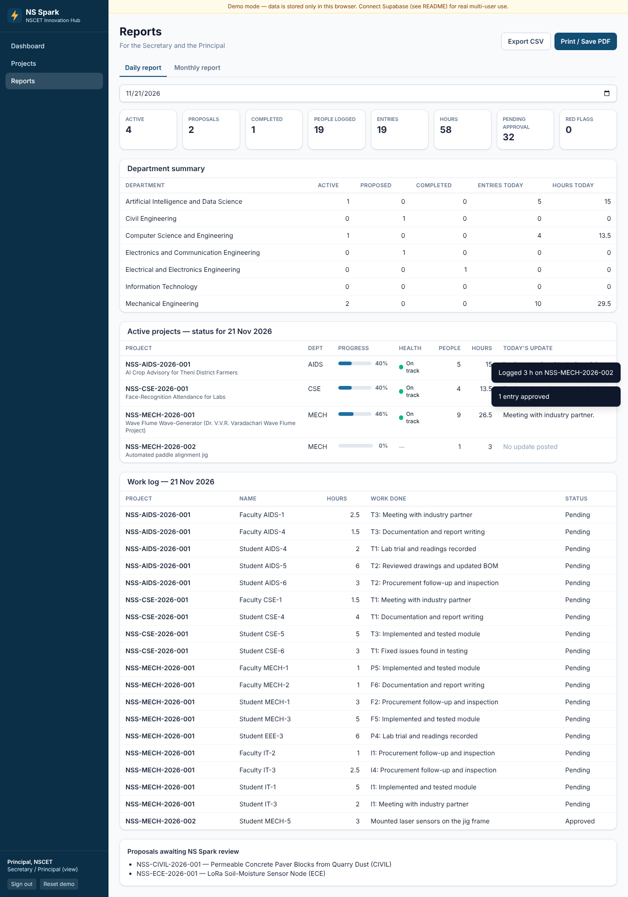

# NS Spark — NSCET Innovation Project Tracker

**Live demo:** https://vigneshls.github.io/nscet-ns-spark/ (demo mode: data is stored only in your browser)

NS Spark is the single umbrella for innovation projects across the seven departments of Nadar Saraswathi College of Engineering and Technology. It works like this:

1. HoDs propose projects.
2. NS Spark reviews and approves them.
3. Faculty and students log their daily work, and project staff approve it.
4. The Secretary and the Principal get a daily and a monthly report.



## Features

- **Role-based panels:** NS Spark Admin, Head of Department, Faculty, Student, and Secretary/Principal (read-only).
- **HoD dashboard:**
  - Active, proposed and completed projects for the department.
  - Hours logged today and over the last 30 days.
  - Entries waiting for approval.
- **Project proposal form:**
  - Title, department and collaborating departments, description, problem, solution, technical stack.
  - Domain, TRL 0–9, stage, IPR status, industry partner, budget and dates. These fields follow IIC/YUKTI.
  - Faculty and student team.
  - Planned tasks grouped by workstream.
- **Review workflow:** approve, request changes or reject, with notes. Codes are assigned automatically (`NSS-MECH-2026-001`).
- **Projects modelled on the Indomer workbook:** workstreams ("towers"), task IDs (F1…, P1…, I1…), and the roles Tower Lead, SME, Lab Technician and Student Intern.
- **Daily timesheet:**
  - Entries are capped at 12 hours per person per day.
  - Backdating is limited to 7 days.
  - Faculty approve entries, and nobody can approve their own.
  - The project view shows a month matrix like the Excel sheet.
- **Daily status per project:** green, amber or red health, with blockers and the next day's plan.
- **Reports:** daily and monthly, ready to print or save as PDF, and exportable to CSV.
- **Admin tools:** user approval and role assignment, and an audit log.

## Two modes

| Mode | When | Data |
|---|---|---|
| **Demo** | `VITE_SUPABASE_*` not set (the default live demo) | Seeded placeholder data in the browser's localStorage; pick any role to sign in |
| **Live** | Supabase URL and anon key set | Shared Postgres database with email/password sign-in, protected by Row Level Security |

## Go live with Supabase (about 15 minutes, free tier)

1. Create a project at [supabase.com](https://supabase.com). Choose the region nearest to you (e.g. Mumbai).
2. Open **SQL Editor**, paste the whole of [`supabase/schema.sql`](supabase/schema.sql) and run it. This creates the tables, the 7 departments, the RLS policies, the triggers and the audit log.
3. Go to **Authentication → URL Configuration** and set Site URL to `https://vigneshls.github.io/nscet-ns-spark/`.
4. Go to **Project Settings → API** and copy the *Project URL* and the *anon public* key.
5. In GitHub, go to repo **Settings → Secrets and variables → Actions → Variables** and add `VITE_SUPABASE_URL` and `VITE_SUPABASE_ANON_KEY`. Then re-run the **Deploy to GitHub Pages** workflow.
6. Open the site and create your own account. In the SQL Editor, run:
   ```sql
   update public.profiles set role = 'admin' where email = 'your-email@nscet.org';
   ```
7. Sign in again. In **Users**, approve each person who signs up and assign their role (HoD, Faculty, Student, Viewer) and department.

The anon key is public by design. It is safe only because RLS is enabled, which `schema.sql` does. Never put the `service_role` key in this repo or in the front end.

**Free-tier limits.** Supabase's free plan pauses a project after a period of inactivity and has database-size and auth-user caps. Check Supabase's current pricing page before relying on it for production. GitHub Pages is free for public repositories.

## Local development

```bash
npm ci
npm run dev        # http://localhost:5173/nscet-ns-spark/
npm test           # unit tests + RLS tests (real Postgres via PGlite)
npm run build      # outputs dist/ (index.html + 404.html)
```

To run against Supabase locally, copy `.env.example` to `.env.local` and fill in the two values.

| Variable | Required | Purpose |
|---|---|---|
| `VITE_SUPABASE_URL` | for live mode | Supabase project URL |
| `VITE_SUPABASE_ANON_KEY` | for live mode | Public anon key (RLS-protected) |

## Stack

- React 19, TypeScript, Vite and Tailwind CSS 4. HashRouter is used so deep links work on GitHub Pages.
- Supabase: Postgres, Auth and Row Level Security. All permission rules are enforced in [`supabase/schema.sql`](supabase/schema.sql).
- Vitest and PGlite. The schema tests run the actual SQL and check the RLS rules, for example that a HoD cannot approve their own proposal, that a student cannot self-approve, and that the 12-hour daily cap holds.

## Project structure

```
src/lib/        types, constants, permission rules, reports, actions, data stores (demo + Supabase), demo seed
src/pages/      Dashboard, Projects, ProjectForm, ProjectDetail, Proposals, Timesheet, Approvals, Reports, Users, Audit
supabase/       schema.sql (tables, RLS, triggers, audit)
tests/          logic.test.ts, schema.test.ts, e2e_flow.py (Playwright happy path)
PROMPT.md       full requirements prompt
```

## Demo accounts

Demo mode only. All names are placeholders. Sign in from the start screen as NS Spark Coordinator, Principal, HoD – MECH, HoD – AIDS, Faculty MECH-1/2, Student MECH-1, or any other seeded user. Use **Reset demo** in the sidebar to restore the seed data.

## Data protection

The app stores staff and student names, emails, register numbers and work logs. The measures in place are:

- Access is restricted by role.
- Timesheets are visible only to their owner, the project staff, the HoD, the admin and management viewers.
- The public demo contains no real names.

For production, record a purpose and retention period in line with India's DPDP Act 2023. This README does not give legal advice.

## License

MIT
